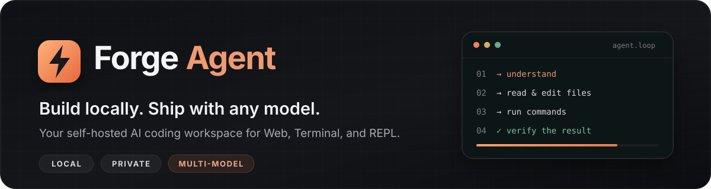
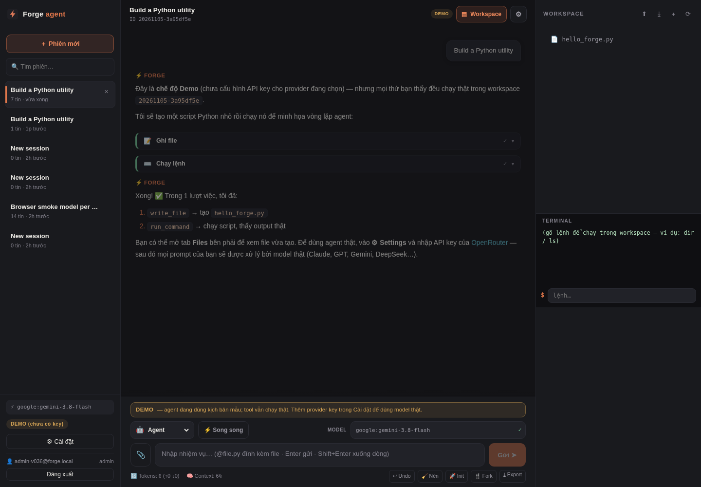
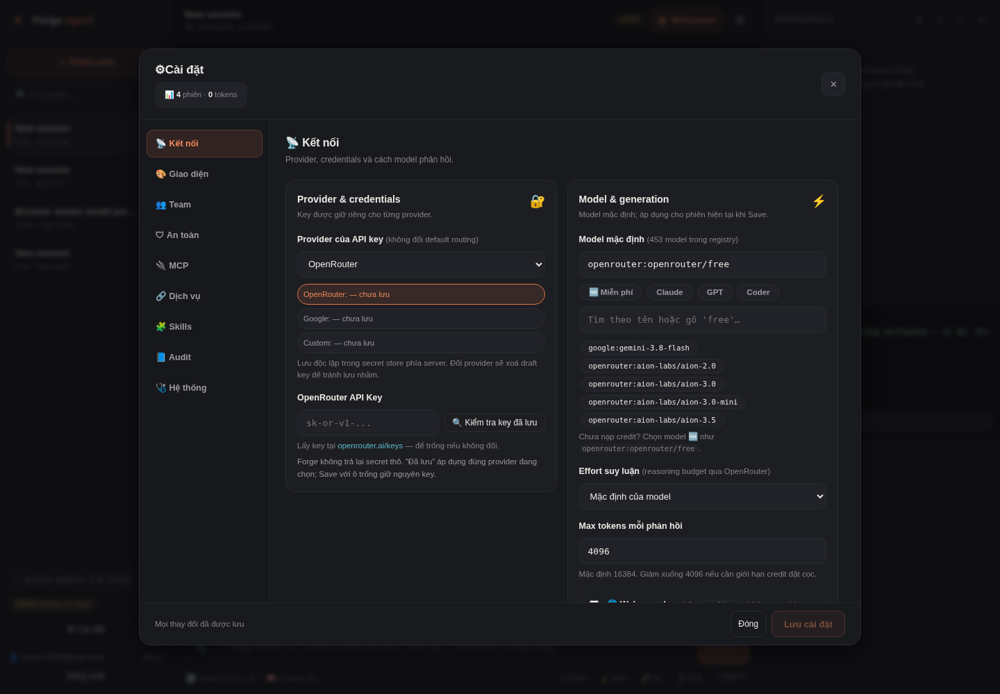
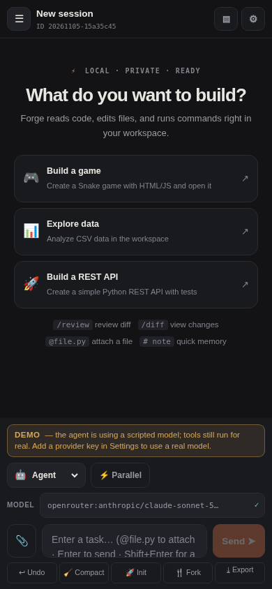

<p align="center">
  
</p>

<p align="center">
  <strong>A self-hosted AI coding workspace for developers who want control.</strong><br>
  Read and edit code, run commands, coordinate agents, and verify the result — from one local engine.
</p>

<p align="center">
  <a href="https://github.com/lxmtuu/Forge-Agent/releases/latest"></a>
  <a href="https://www.python.org/"></a>
  <a href="https://react.dev/"></a>
  <a href="#security-and-privacy"></a>
</p>

<p align="center">
  <a href="https://github.com/lxmtuu/Forge-Agent/releases/latest"><strong>Download the latest release</strong></a>
  · <a href="#quick-start">Quick start</a>
  · <a href="docs/guides/USER_GUIDE.md">User guide</a>
  · <a href="docs/guides/SECURITY.md">Security</a>
  · <a href="docs/guides/DEPLOY.md">Deployment</a>
</p>

---

## Build with an agent, not just a chat box

Forge Agent gives you the engine, interface, sessions, workspaces, and data. Use the scripted demo without an API key, connect OpenRouter or Google Gemini, or point Forge at an OpenAI-compatible local provider such as Ollama or LM Studio.

<p align="center">
  <a href="docs/assets/forge-web-agent.png">
    
  </a>
  <sub>The real v0.38 English Web UI, captured with demo data and no real provider credentials.</sub>
</p>

## Why Forge Agent?

<table>
  <tr>
    <td width="50%" valign="top">
      <h3>⚡ A complete agent loop</h3>
      <p>Read files, search a codebase, edit code, run commands, inspect results, and continue until the task is complete. Reasoning, tool calls, diffs, and outcomes stay visible.</p>
    </td>
    <td width="50%" valign="top">
      <h3>🧠 Multi-model by design</h3>
      <p>Route OpenRouter, Gemini, and custom providers per session. Browse model pricing and context metadata, configure fallbacks, and track token usage and cost.</p>
    </td>
  </tr>
  <tr>
    <td width="50%" valign="top">
      <h3>🔀 Parallel agents and model battles</h3>
      <p>Fan out independent tasks, spawn sub-agents, isolate work in worktrees, or compare up to four models on the same prompt before choosing a winner.</p>
    </td>
    <td width="50%" valign="top">
      <h3>🛡️ Safety you control</h3>
      <p>Guarded command classification, interactive approvals, allow/deny patterns, workspace path confinement, audit logs, and an optional Docker sandbox are built in.</p>
    </td>
  </tr>
  <tr>
    <td width="50%" valign="top">
      <h3>🧩 Extensible by default</h3>
      <p>Add MCP tools, Agent Skills, custom commands, custom agents, lifecycle hooks, and provider profiles without replacing the core engine.</p>
    </td>
    <td width="50%" valign="top">
      <h3>🗂️ Persistent, practical workspaces</h3>
      <p>Keep sessions and files together, upload or export projects, use <code>@file</code> references, create checkpoints, undo agent actions, and compact long conversations.</p>
    </td>
  </tr>
</table>

## A focused interface, wherever you work

The responsive Web app keeps the conversation, model controls, workspace, terminal, and session actions within reach. Settings are organized by task, while desktop, tablet, and mobile layouts preserve the same workflow.

<table>
  <tr>
    <td width="68%" align="center" valign="top">
      <strong>Provider and model controls</strong><br><br>
      <a href="docs/assets/forge-web-settings.png"></a>
    </td>
    <td width="32%" align="center" valign="top">
      <strong>Responsive Web UI</strong><br><br>
      <a href="docs/assets/forge-web-mobile.png"></a>
    </td>
  </tr>
</table>

## One engine, every workflow

| Mode | Best for | What Forge does |
|---|---|---|
| **💬 Direct** | Fast questions and explanations | Streams a response without agent tools. |
| **🤖 Agent** | Implementation and debugging | Runs the full read → edit → command → verify loop. |
| **📋 Plan** | Safe exploration and design | Uses read-only tools to produce a plan before changes. |
| **🧭 Architect** | Larger tasks with separate planning and execution | Lets a strong model plan and a cheaper model implement. |
| **⚔ Battle** | Comparing answers or approaches | Runs the same prompt across up to four models in isolated sessions. |

### Built for real development

- **Code intelligence:** repository maps, LSP diagnostics and navigation, `/review`, `/diff`, and automatic repair feedback.
- **Memory and context:** `AGENTS.md`, imported project rules, quick memory, persistent lessons, and manual or automatic compaction.
- **Automation:** background shell commands, background agents, scheduled `/loop` tasks, lifecycle hooks, and headless JSON for scripts and CI.
- **Collaboration:** optional accounts, admin/member boundaries, Google OIDC, per-user sessions and workspaces, and exportable audit history.
- **Vietnamese + English UI:** switch languages on the login screen or in **Settings → Appearance**. The choice is saved on the device, and scripted demos follow the selected language.
- **Clear diagnostics:** provider errors remain visible, empty responses fail closed, and `scripts/diagnose_llm.py` tests real streaming without writing a session.

## Quick start

### 1. Get Forge Agent

**Recommended:** download and extract [the latest release ZIP](https://github.com/lxmtuu/Forge-Agent/releases/latest). It includes the production Web bundle, so a separate npm build is not required.

Or clone the repository:

```bash
git clone https://github.com/lxmtuu/Forge-Agent.git
cd Forge-Agent
```

### 2. Launch

**Windows** — double-click `run_forge.bat`, or run:

```powershell
.\run_forge.bat
```

**macOS / Linux:**

```bash
chmod +x run_forge.sh
./run_forge.sh
```

The launcher creates a virtual environment, installs dependencies, prepares the Web UI, and opens **http://localhost:8000**. You can explore demo mode immediately; the model is scripted, while demo tool calls still execute in the workspace.

### 3. Connect a provider when you are ready

```bash
python scripts/setup_keys.py --provider openrouter
# or
python scripts/setup_keys.py --provider google
```

Keys are entered hidden and stored server-side, outside the source tree. You can also use **Settings → Connection** on a private installation. Never commit API keys or share them in chat.

For Docker and public deployments, follow [DEPLOY.md](docs/guides/DEPLOY.md) and the [security checklist](docs/guides/SECURITY.md).

## Use it your way

```bash
pip install -e .

forge                         # Full-screen terminal UI
forge --web                   # Web interface
forge --repl                  # Lightweight interactive REPL
forge --once "Add validation and run the tests"
forge --parallel "Write tests" "Review the API" "Update the docs"
```

The same engine powers every interface:

```text
React Web UI ───────┐
Rich Terminal UI ───┼──► Forge agent engine ──► tools + sessions + workspaces
Interactive REPL ───┘              │
                                   ├── OpenRouter / Google Gemini
                                   ├── Custom OpenAI-compatible providers
                                   └── MCP servers, skills, and hooks
```

## Security and privacy

- Provider secrets stay on the server and are never returned in full to the browser.
- Workspaces restrict file paths, while guarded mode and approvals help control shell execution.
- Account sessions use HttpOnly cookies and CSRF protection; owner ACLs isolate application-level sessions and workspaces.
- Optional Docker execution can disable networking and limit CPU, memory, and capabilities.
- Release mode, HTTPS deployment, rate limits, and shared-server hardening are documented in [SECURITY.md](docs/guides/SECURITY.md).

> **Important:** prompts and relevant workspace content are still sent to the model provider you select. Forge's owner ACLs are designed for trusted teams, not as an OS sandbox between hostile users.

## Release verification

**v0.38.0** was verified from the extracted release archive:

- **228/228 checks passed across 35 test suites.**
- **149/149 extracted files** matched their expected SHA-256 hashes.
- Chromium regressions: **37/37 responsive UX**, **23/23 English/i18n**, and **1/1 persistent provider-error** checks passed.
- TypeScript, Vite (43 modules), mypy (39 source files), scoped Ruff, Bandit Medium+, archive integrity, and secret scans passed.

See [PROJECT_AUDIT.md](docs/reports/PROJECT_AUDIT.md) for engineering notes and release evidence.

## Documentation

| Document | What you will find |
|---|---|
| [QUICKSTART.md](docs/guides/QUICKSTART.md) | A compact setup path |
| [USER_GUIDE.md](docs/guides/USER_GUIDE.md) | Step-by-step user guide in Vietnamese |
| [SECURITY.md](docs/guides/SECURITY.md) | Security model and hardening checklist |
| [DEPLOY.md](docs/guides/DEPLOY.md) | Docker, VPS, and production deployment |
| [MCP_CATALOG.md](docs/guides/MCP_CATALOG.md) | MCP servers and connector presets |
| [BUILD_DESKTOP.md](docs/guides/BUILD_DESKTOP.md) | Standalone desktop packaging |
| [PRODUCT_DIRECTION.md](docs/reports/PRODUCT_DIRECTION.md) | Product principles and direction |

---

<p align="center">
  <strong>Own the workspace. Choose the model. Stay in control.</strong><br>
  <a href="https://github.com/lxmtuu/Forge-Agent/releases/latest">Download Forge Agent v0.38.0</a>
</p>
